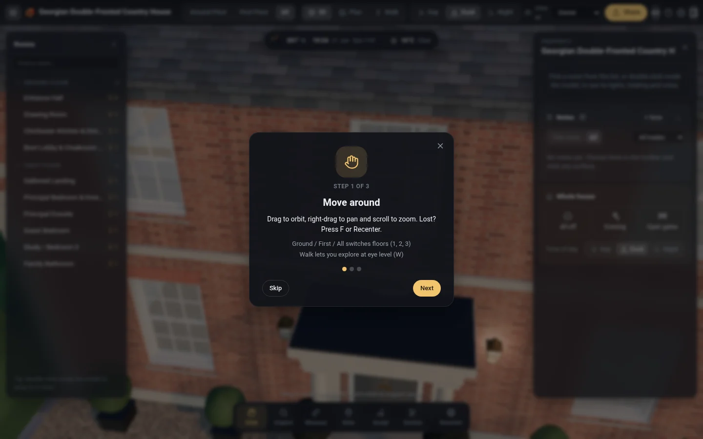
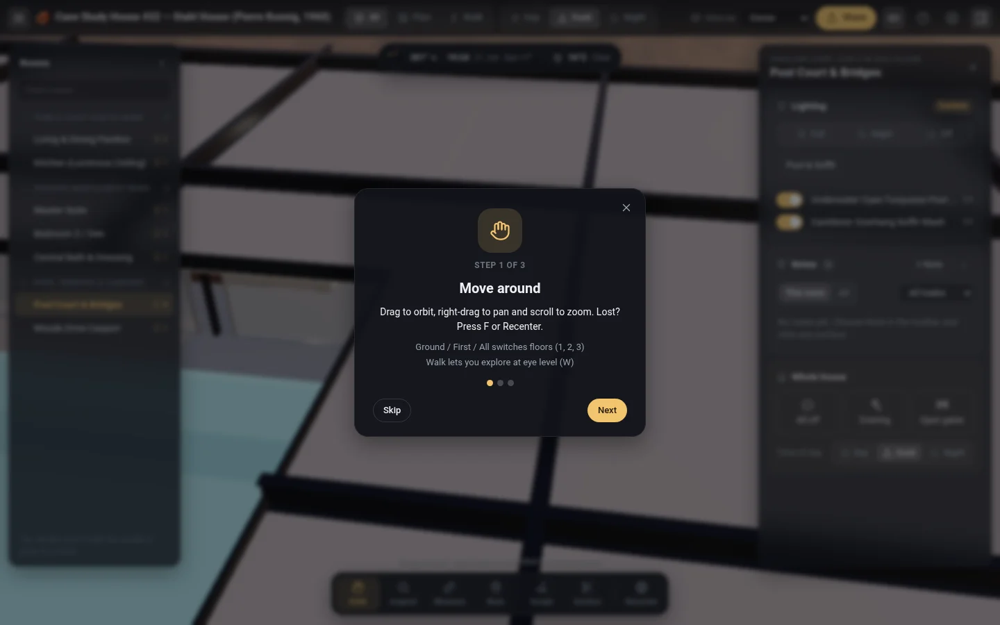
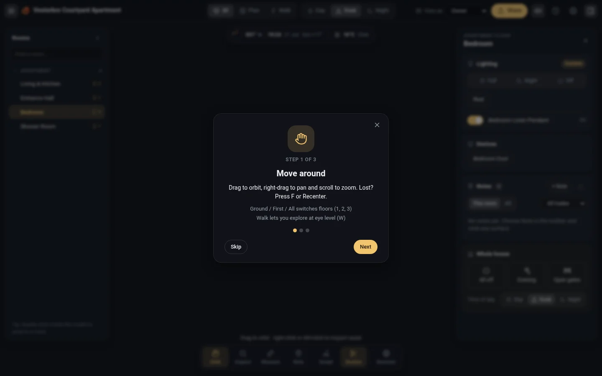

<p align="center">
  
</p>

<h1 align="center">Hus</h1>

<p align="center">
  3D home and architectural models in TypeScript and Three.js.
  <br />
  <a href="https://alexemorris.github.io/hus/">Live Demo</a> &middot;
  <a href="https://github.com/alexemorris/hus/actions/workflows/ci.yml">CI</a> &middot;
  <a href="./LICENSE">MIT License</a>
</p>

Hus (`husjs`) is a TypeScript library for modelling buildings, rooms, lighting, and interiors in code and exploring them in the browser.

[](https://alexemorris.github.io/hus/)

| [Georgian Country House](https://alexemorris.github.io/hus/) | [Stahl House (Case Study #22)](https://alexemorris.github.io/hus/?house=stahl-house) | [Pied-à-terre Apartment](https://alexemorris.github.io/hus/?house=simple-flat) |
| :---: | :---: | :---: |
| [](https://alexemorris.github.io/hus/) | [](https://alexemorris.github.io/hus/?house=stahl-house) | [](https://alexemorris.github.io/hus/?house=simple-flat) |
| `examples/simple-house` | `examples/stahl-house` | `examples/simple-flat` |

## Getting started

```bash
git clone https://github.com/alexemorris/hus.git
cd hus
npm install
npm run dev
```

## Usage

A house is defined with floors, rooms, and lighting zones, then mounted into the page:

```ts
import 'husjs/styles.css';
import { defineHouse, mountHouse } from 'husjs';

export const house = defineHouse({
  id: 'courtyard-house',
  name: 'Courtyard House',
  location: { lat: 51.84, lon: -1.79, timezone: 'Europe/London' },
  floors: [
    { id: 'ground', label: 'Ground Floor', shortLabel: 'G', order: 0, elevationY: 0, ceilingCutawayY: 2.8 },
  ],
  rooms: {
    manifest: [{ zoneId: 'hall', label: 'Entrance Hall', floor: 'ground', group: 'Ground Floor' }],
    navTree: [{ id: 'ground', label: 'Ground Floor', roomIds: ['hall'] }],
  },
  zones: {
    circuitMaxIntensity: { hallPendant: 8.0 },
    modules: [],
  },
});

await mountHouse(house, document);
```

## What's included

- **Architecture & interiors**: helpers for walls, openings, roofs, stairs, joinery, paint colours, brick/stone textures, and a built-in furniture and fixture catalog (`husjs/objects`, `husjs/materials`, `husjs/catalog/*`).
- **Viewer & walkthrough**: orbit, floor-plan, and first-person walking modes, automatic wall cutaways, and room annotations (`husjs/viewer`, `husjs/ui`).
- **Environment & lighting**: sun/moon position by date and location, sky/weather presets, terrain heightmaps, and room switches/dimmers with optional KNX and UniFi adapters (`husjs/knx`, `husjs/unifi`).
- **Checks & schedules**: `npx husjs audit` checks for coplanar z-fighting, blocked door swings, and stair headroom; `npx husjs schedule` exports placed fixtures to Markdown, CSV, or JSON; `npx husjs export` writes `.glb`.

## Development

```bash
npm test              # unit & example tests
npm run typecheck     # TypeScript check
npx husjs audit --all-examples
npm run build         # production bundle
```

## License

[MIT](./LICENSE)
